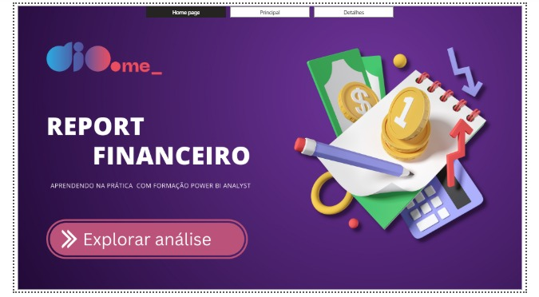
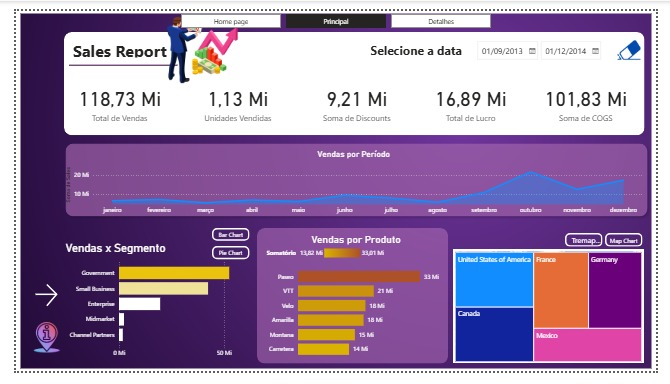
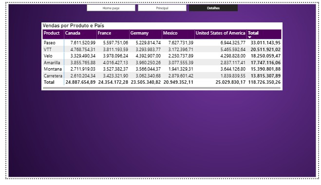

# Desafio DIO: Atualizando Relatório Financeiro com Foco na Experiência do Usuário

Projeto prático do desafio da DIO. Parti do relatório **Sales Report**, fornecido no curso, e o melhorei pensando em quem vai usá-lo: navegação entre páginas, legibilidade e uma nova página de detalhes.

## 🖼️ Prévia

### Home

### Principal

### Detalhes

## 📄 Páginas do relatório

| Página | O que mostra |
|---|---|
| **Home** | Página de abertura do relatório, com o menu de navegação |
| **Principal** | Indicadores (cartões), vendas por período, vendas por segmento, vendas por produto e vendas por país, com filtro de datas |
| **Detalhes** | Matriz de vendas por produto e país |

## 🔧 O que eu alterei no relatório original

1. **Cartão repetido corrigido:** o relatório mostrava "Soma de Discounts" duas vezes, com o mesmo valor. Troquei o segundo por **Total de Lucro** (`Profit`), que traz uma informação nova.
2. **Menu de navegação nas 3 páginas:** usei o **navegador de páginas** do Power BI, com um botão para cada página. Criei o menu na página Principal e copiei para as outras duas.
3. **Efeito nos botões:** configurei os estados **Ao focalizar** (o botão muda de cor ao passar o mouse) e **Selecionado** (o botão da página atual fica destacado).
4. **Nova página Detalhes:** criei a terceira página, com o mesmo fundo roxo das outras, para o relatório ter 3 páginas.
5. **Matriz de vendas:** na página Detalhes, uma matriz com **produtos nas linhas**, **países nas colunas** e a **soma de vendas** nos valores. Dá para comparar quanto cada produto vendeu em cada país e ver os totais.
6. **Contraste na matriz:** cabeçalho em roxo escuro com texto branco, combinando com o tema do relatório e ficando legível.

## 🎯 Pontos de experiência do usuário considerados

| Ponto | Como apliquei |
|---|---|
| **Posicionamento** | Menu de navegação sempre no mesmo lugar, no topo das 3 páginas |
| **Contraste** | Cabeçalho da matriz em roxo escuro com texto branco |
| **Segmentação** | Filtro de datas e botões que alternam o tipo de gráfico (barras/pizza e treemap/mapa), mantidos do relatório original |

## 📁 Conteúdo do repositório

- `desafio-6-power-bi.pbix`: projeto do Power BI
- `pagina-home.jpeg`, `pagina-principal.jpeg`, `pagina-detalhes.jpeg`: prints das páginas
- `README.md`: este arquivo

## ▶️ Como abrir

1. Instale o **Power BI Desktop** (gratuito, só para Windows).
2. Baixe o arquivo `desafio-6-power-bi.pbix`.
3. Abra no Power BI Desktop.
4. Para testar os botões, segure **Ctrl** e clique neles.

## 🧠 O que aprendi

[Escreva 2 ou 3 frases com suas palavras. Por exemplo: como criar um menu de navegação, configurar o efeito dos botões ao focalizar e selecionar, e usar contraste para melhorar a leitura.]

## 🔗 Referências

- Repositório do curso: https://github.com/julianazanelatto/power_bi_analyst
